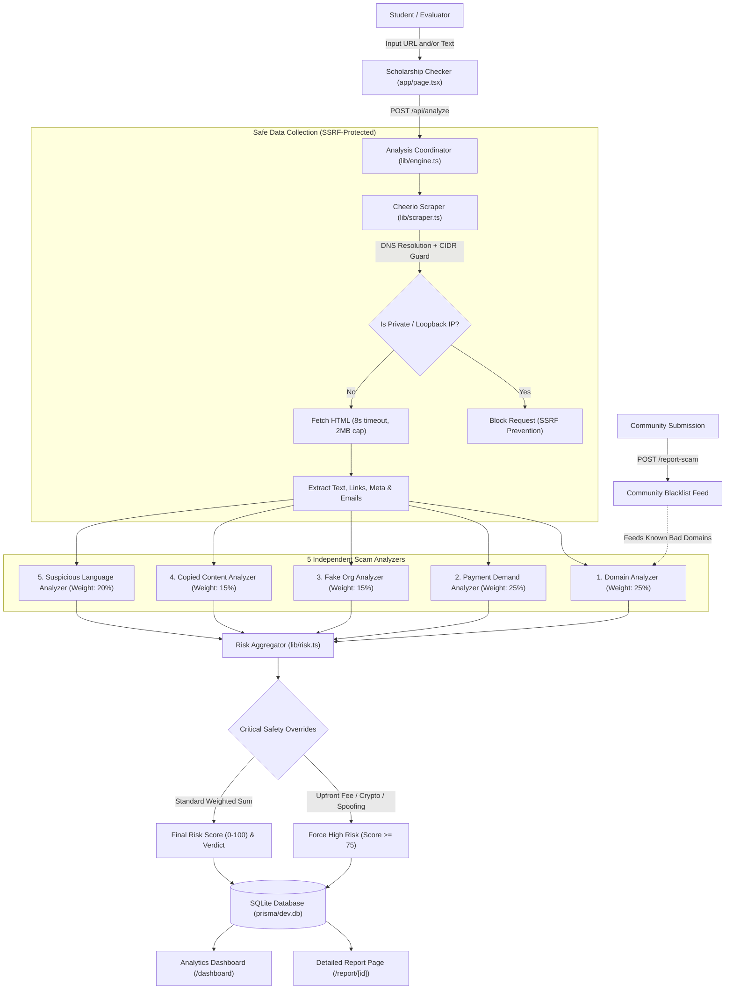

# ScholarShield 🛡️
### Automated Scholarship Scam Detection & Verification Portal
*University Continuous Assessment Project • Next.js 15, TypeScript, Prisma (SQLite), Tailwind CSS, Vitest*

---

## 1. Project Overview

ScholarShield is a full-stack, modular web application engineered to protect students and applicants from scholarship advance-fee fraud, brand impersonation, and phishing scams. 

Applicants paste a scholarship website URL and/or its text announcement. ScholarShield runs safe, SSRF-protected data collection, passes the content through **5 modular scam analyzers**, and computes a composite **0–100 Risk Score** categorized into **Safe (0–30)**, **Suspicious (31–65)**, or **High Risk (66–100)** with evidence-backed diagnostic explanations and an actionable safety checklist.

### Core Architecture Flow



---

## 2. Tech Stack & Engineering Decisions

| Component | Technology | Architecture Rationale |
| :--- | :--- | :--- |
| **Framework** | **Next.js 15 (App Router)** | Strict React Server Components (RSC) by default for zero client bundle bloat; Client Components used only for interactive charts, form states, and theme toggling. |
| **Language** | **TypeScript 5.7** | Strict type definitions across analyzers, scraped payloads, database queries, and API route handlers. |
| **Database & ORM** | **Prisma ORM with SQLite** | Zero external database setup (`file:./dev.db`). Enables instant migration, local grading, and self-contained execution. |
| **Styling & Theme** | **Tailwind CSS + next-themes** | Accessible modern design system, responsive layouts, accessible semantic HTML, and Dark/Light mode toggle. |
| **Data Visualization**| **Recharts** | Real-time SVG charts for risk distribution (Donut), top fraud categories (Bar), and scan history trends (Area). |
| **Data Extraction** | **Cheerio + Native Fetch** | Fast HTML parsing without spinning heavy headless browsers, accompanied by custom SSRF guardrails. |
| **Validation** | **Zod** | End-to-end schema validation on incoming scan payloads and community scam reports. |
| **Testing** | **Vitest** | Fast unit test suite covering all 5 analyzers, edge cases, and SSRF security checks. |
| **APIs** | **Free Public Endpoints Only** | No paid API keys or external subscriptions required. Uses free public RDAP protocol for domain age lookups with offline fallbacks. |

---

## 3. Quick Start & Setup Instructions

ScholarShield is designed to run locally from a clean clone with zero configuration.

### Prerequisites
- Node.js version 18.18+ or 20+ (tested on Node v24)
- npm version 9+

### 1. Clone & Install Dependencies
```bash
git clone <repository-url>
cd scholarshield
npm install
```

### 2. Configure Environment Variables
Copy `.env.example` to `.env` (already configured for SQLite by default):
```bash
cp .env.example .env
```
Default `.env` contents:
```env
DATABASE_URL="file:./dev.db"
NEXT_PUBLIC_APP_URL="http://localhost:3000"
```

### 3. Run Database Migrations & Seed Data
```bash
npx prisma migrate dev
npm run seed
```
> **What this does:**
> - Creates `prisma/dev.db` SQLite database with the full schema.
> - Seeds 25 verified legitimate world-renowned scholarships (Fulbright, Chevening, DAAD, MEXT, Erasmus Mundus, etc.).
> - Seeds 15 known malicious look-alike domains and scam tropes.
> - Seeds initial community reports and representative scan reports for instant dashboard visualization.

### 4. Run Unit Test Suite
```bash
npm test
```
Runs 28 automated Vitest unit tests verifying every analyzer, similarity algorithms, Levenshtein distance, SSRF guards, and acceptance criteria.

### 5. Start Development Server
```bash
npm run dev
```
Open [http://localhost:3000](http://localhost:3000) in your browser.

---

## 4. The 5 Modular Scam Analyzers: Logic & Mechanics

Each analyzer is implemented in an isolated module under `lib/analyzers/` returning `{ score, weight, flags, evidence, details }`.

### 1. Domain Analyzer (`lib/analyzers/domain-analyzer.ts`) — Weight: 25%
- **Typosquatting Detection:** Implements standard dynamic programming **Levenshtein Distance** against all 25 verified official domains:
  $$\text{dist}(s_1, s_2) \le 2 \implies \text{Flagged as Typosquatting Look-alike}$$
  *(e.g., detecting `chevening.com` vs `chevening.org`, or `daab.de` vs `daad.de`)*.
- **Brand Hijacking:** Flags domains embedding protected brands (e.g., `fulbright`, `chevening`, `daad`, `mext`, `erasmus`) when hosted on unofficial root domains (e.g., `fulbright-grants.xyz`).
- **High-Risk TLD Verification:** Identifies throwaway TLDs statistically associated with disposable phishing campaigns (`.xyz`, `.top`, `.click`, `.loan`, `.work`, `.icu`, `.buzz`, `.cam`, etc.).
- **Structural Heuristics:** Flags excessive domain hyphenation ($\ge 2$ hyphens) and deep subdomain chains ($\ge 3$ subdomains).
- **Public RDAP Age Lookup:** Queries free public RDAP (`https://rdap.org/domain/{domain}`) to identify domains created less than 90–180 days ago.
- **Community Blacklist Integration:** Cross-references submitted URLs against the `KnownBadDomain` SQLite table.

### 2. Payment Demand Analyzer (`lib/analyzers/payment-analyzer.ts`) — Weight: 25%
*The Golden Rule of Scholarships: "Scholarships give you money; they never ask you for money."*
- **Application & Handling Fees:** Flags fee solicitation terms (`application fee`, `processing charge`, `registration fee`, `dossier fee`, `evaluation cost`).
- **Exoneration Context Filter:** Intelligently ignores negative phrases (e.g., *"no application fee"*, *"completely free of charge"*, *"never asks for payment"*), preventing false positives on legitimate listings.
- **Refundable Deposit Scam Trope:** Detects requests for *"refundable security guarantee"*, *"attendance deposit"*, or *"bond"*.
- **Untraceable Wire Transmitters:** Flags Western Union, MoneyGram, and Ria transfer demands.
- **Cryptocurrency Demands:** Identifies Bitcoin, USDT, Ethereum, Tron TRC-20, and hex wallet addresses (`0x...`).
- **Gift Card Demands:** Flags retail vouchers (Amazon, Apple iTunes, Steam, Google Play, Razer Gold).
- **Off-Platform Chat Routing:** Flags instructions to conduct payment negotiations via WhatsApp or Telegram.

### 3. Fake Organization Analyzer (`lib/analyzers/fake-org-analyzer.ts`) — Weight: 15%
- **Free Webmail Contact Alert:** Flags official scholarship contacts utilizing commercial free email providers (`@gmail.com`, `@yahoo.com`, `@hotmail.com`, `@outlook.com`, `@proton.me`). Legitimate granting authorities operate on dedicated `.gov`, `.edu`, or institutional domains.
- **Fabricated Authority Heuristics:** Catches grandiose fictitious bureaus (*"International Scholarship Disbursal Commission"*, *"World Education Grant Office"*, *"Central Youth Allocation Board"*).
- **Registry Cross-Referencing:** If an applicant claims association with a recognized entity (e.g. *Fulbright Foreign Student Program*), the analyzer checks whether the host domain matches the accredited registry.
- **Physical Address & Telephone Detection:** Verifies the presence of verifiable street identifiers, postal codes, and headquarters contact details.

### 4. Copied Content Analyzer (`lib/analyzers/copied-content-analyzer.ts`) — Weight: 15%
- **3-Gram Word Shingling:** Tokenizes text into lowercase n-gram tuples after stripping common English stop words.
- **Jaccard Similarity Index:**
  $$J(A, B) = \frac{|A \cap B|}{|A \cup B|}$$
  Compares the scanned listing's shingle set $A$ against the corpus shingle sets $B$ of the 25 verified legitimate scholarships.
- **Plagiarism vs. Authenticity Rule:**
  - If $J(A, B) \ge 0.40$ on the **official domain** $\implies$ **Authentic Text Verified (Score: 0)**.
  - If $J(A, B) \ge 0.40$ on an **unauthorized domain** $\implies$ **Stolen Copycat / Plagiarism Scam (Score: 85+)**.

### 5. Suspicious Language Analyzer (`lib/analyzers/suspicious-language-analyzer.ts`) — Weight: 20%
- **High-Pressure Artificial Urgency:** Detects countdown manipulation (*"apply within 24 hours"*, *"deadline expires tonight"*, *"only 3 spots left"*).
- **Unrealistic Guarantees:** Detects *"100% guaranteed approval"*, *"everyone wins"*, *"no GPA required"*, and *"no essay needed"*.
- **Sensitive PII & Financial Solicitations:** Flags phishing for banking login passwords, ATM PINs, OTP codes, card CVVs, Social Security Numbers (SSN), Aadhaar numbers, and passport scans.
- **Spam Formatting Heuristics:** Calculates uppercase shout-word ratios and excessive exclamation clusters (*"!!!"*).

---

## 5. Risk Aggregator & Safety Overrides

The **Risk Aggregator (`lib/risk.ts`)** combines all 5 analyzer scores using a weighted base formula:

$$\text{BaseScore} = (S_{\text{Domain}} \times 0.25) + (S_{\text{Payment}} \times 0.25) + (S_{\text{FakeOrg}} \times 0.15) + (S_{\text{Content}} \times 0.15) + (S_{\text{Language}} \times 0.20)$$

### Critical Safety Overrides (Guardrails)
To guarantee student safety, mathematical weighting alone is insufficient. If a severe fraud marker is detected, ScholarShield enforces strict minimum floors:
- If a **CRITICAL Payment Flag** exists (direct application fee, crypto wallet, gift card, Western Union) OR a **Brand Impersonation / Blacklist Match** occurs:
  $$\text{FinalScore} \ge 78 \implies \mathbf{HIGH\_RISK}$$
- If **Plagiarized Official Content** is detected on an unverified domain:
  $$\text{FinalScore} \ge 68 \implies \mathbf{HIGH\_RISK}$$

---

## 6. SSRF Protection & Safe Web Scraping

ScholarShield implements multi-layer SSRF (Server-Side Request Forgery) protection in `lib/scraper.ts`:
1. **Protocol Restriction:** Only `http:` and `https:` schemes are permitted.
2. **Localhost & Reserved Hostname Blocking:** Rejects `localhost`, `*.local`, `*.internal`, `*.arpa`, and IPv6 `::1`.
3. **Private IP Range Validation:** Blocks loopback and private IPv4/IPv6 CIDR subnets:
   - `127.0.0.0/8` (Loopback)
   - `10.0.0.0/8` (Private Class A)
   - `172.16.0.0/12` (Private Class B)
   - `192.168.0.0/16` (Private Class C)
   - `169.254.0.0/16` (Link-Local)
   - `0.0.0.0/8`
4. **DNS Rebinding Prevention:** Performs an asynchronous DNS lookup before connecting to ensure the resolved IP does not route to internal infrastructure.
5. **Payload Limiter & Timeout:** Maximum 2MB stream size cap and an 8-second `AbortController` timeout to prevent Denial-of-Service attacks.

---

## 7. Database Models (Prisma & SQLite)

```prisma
// Scan Results
model ScanReport {
  id              String   @id @default(cuid())
  url             String?
  domain          String?
  title           String?
  targetOrg       String?
  rawText         String
  riskScore       Int
  verdict         String   // SAFE | SUSPICIOUS | HIGH_RISK
  confidence      String   // LOW | MEDIUM | HIGH
  summary         String
  topReasons      String   // JSON string array
  analyzerResults String   // JSON serialized breakdown
  flags           String   // JSON serialized array
  metadata        String?  // JSON: SSL, age, emails
  createdAt       DateTime @default(now())
}

// Community Submissions
model CommunityReport {
  id             String   @id @default(cuid())
  url            String
  domain         String
  orgName        String?
  scamType       String
  description    String
  evidenceNotes  String?
  reporterEmail  String?
  status         String   @default("VERIFIED")
  createdAt      DateTime @default(now())
}

// Malicious Domains Blacklist
model KnownBadDomain {
  id             String   @id @default(cuid())
  domain         String   @unique
  reason         String
  source         String
  reportedCount  Int      @default(1)
  createdAt      DateTime @default(now())
}

// Verified Global Scholarships Directory
model LegitScholarship {
  id             String   @id @default(cuid())
  name           String
  slug           String   @unique
  officialDomain String
  organization   String
  country        String
  coverage       String
  officialUrl    String
  description    String
  verified       Boolean  @default(true)
}
```

---

## 8. Viva & Academic Presentation Guide

When presenting ScholarShield for continuous assessment, follow this demonstration script:

### Step 1: Open Home Page (`/`)
Point out the dual input options (URL and/or pasted text) and show the **Quick Viva Demonstrator bar** at the top.

### Step 2: Test a Verified Legitimate Scholarship
Click **"Legit: Fulbright Program"** or **"Legit: Chevening UK"** and click **Run Scam Verification**.
- Shows animated 7-stage scanner progress.
- Redirects to `/report/[id]`.
- Demonstrates **Risk Score: 5/100 (Safe)**, green radial gauge, official domain verification badge, and 0 fee flags.

### Step 3: Test an Advance-Fee Scam
Click **"Scam: $15k Grant & Wire Fee"** and run verification.
- Demonstrates **Risk Score: 78/100 (High Risk)**, red radial gauge.
- Expands the analyzer cards to inspect:
  - *Domain Analyzer:* Flagged `.xyz` TLD, excessive hyphens, and blacklist entry.
  - *Payment Demand Analyzer:* Flagged application fee and Western Union wire.
  - *Suspicious Language Analyzer:* Flagged 100% guarantee and artificial urgency.
- Shows actionable *"DO NOT pay any fees"* student checklist.

### Step 4: Test a Brand Impersonation Scam
Click **"Scam: Fulbright WhatsApp Lure"**.
- Highlights the **Copied Content Analyzer** detecting 100% 3-gram text match from Fulbright on an unauthorized domain (`fulbright-grants.xyz`), triggering the plagiarism impersonation alarm.

### Step 5: Explore the Dashboard (`/dashboard`)
- Point out the real-time **Recharts Donut Chart** (Risk Distribution), **Bar Chart** (Fraud Categories), and **Timeline Area Chart**.
- Search and filter past scans in the interactive table.

### Step 6: Community Reporting (`/report-scam`) & Learn Portal (`/learn`)
- Submit a new scam URL and show how it automatically populates the `KnownBadDomain` blacklist.
- Show the 7 Red Flags guide and the searchable 25+ verified scholarship directory.

---

## 9. Limitations & Future Scope

### Current Limitations
1. **JavaScript-Rendered Content (SPAs):** Fast Cheerio-based scraping extracts raw HTML without executing client-side client JavaScript frameworks. Single Page Applications (SPAs) rendering all text client-side may return limited visible text unless pasted manually.
2. **Dynamic RDAP Rate Limits:** Free public RDAP endpoints (`rdap.org`) apply IP rate limiting; in restricted network environments, domain age gracefully falls back to neutral scores.
3. **Multilingual Content:** Current regex and n-gram shingling models are optimized for English-language scholarship listings.

### Future Scope & Roadmap
- **Browser Extension:** A lightweight Chrome/Firefox extension that automatically checks scholarship application portals and injects a real-time safety badge.
- **Transformer NLP Classifier:** Fine-tuning a lightweight BERT/RoBERTa model on student fraud corpora for nuanced tone classification.
- **Multilingual Expansion:** Expanding heuristics and stop-word dictionaries to Spanish, French, German, and Arabic international scholarship drives.
- **Institution Webhook Verification:** Enabling university financial aid offices to claim and officially verify their scholarship listings via DNS TXT records.

---

## 10. License & Credits

Built for University Continuous Assessment coursework. 
- **License:** MIT License.
- **Author:** ScholarShield Academic Team.

